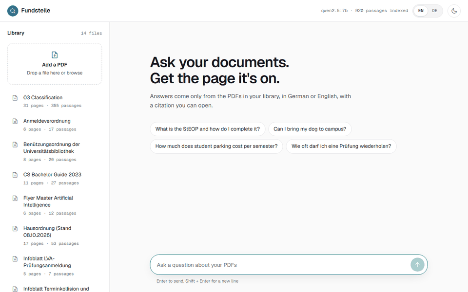
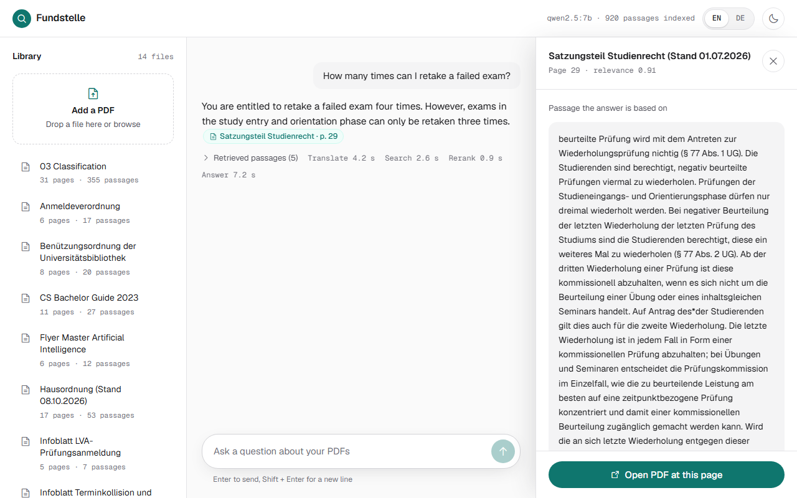
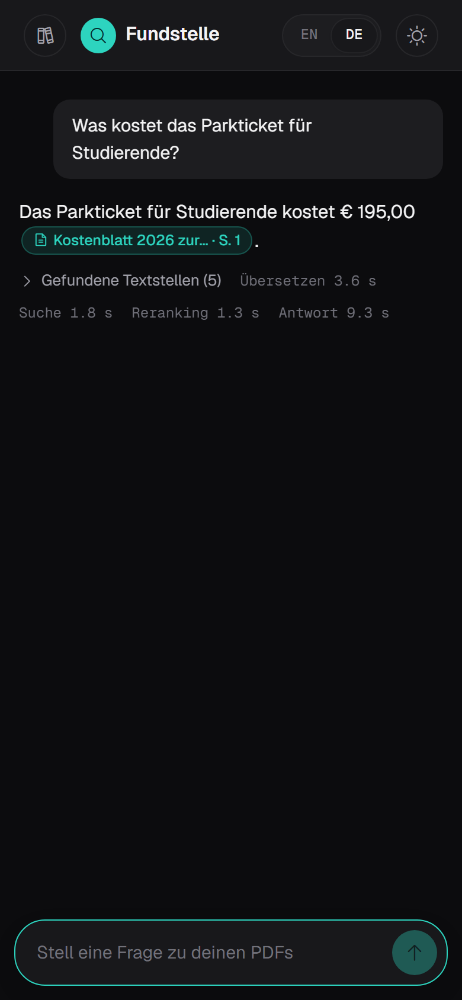
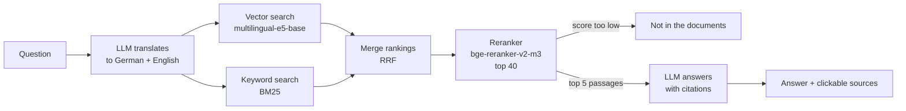

# Fundstelle: a document assistant that cites its sources

Ask questions about your PDFs in German or English. Every answer links to the exact file and page it comes from. If the documents don't contain the answer, it says so instead of guessing.

Built as a retrieval-augmented generation (RAG) system that runs locally on a laptop GPU, and **measured on 100 hand-labelled questions** at every step.



<sub>Demo with public JKU Linz study documents. The wait for the answer is sped up in the GIF.</sub>

## Results

Measured on hand-labelled questions with the file and page(s) that contain the answer. The final setup was tuned on 80 questions, then checked once on **20 new questions it had never seen**.

| | Plain vector search (tuning set) | Final pipeline (tuning set) | **Final pipeline (held-out set)** |
|---|---|---|---|
| Right page ranked #1 | 53% | 90% | **88%** |
| Right page in top 5 (recall) | 73% | 99% | **94%** |
| MRR | 0.62 | 0.93 | **0.91** |
| English questions about German documents, top 5 | 46% | 96% | **83%** |

**Answers** (80-question set, local 7B model): **89%** handled correctly (a correct answer, or a correct "not in the documents"). All 10 unanswerable questions were refused, half of them before the LLM was even called. 90% of answers cite a page that really contains the answer. On the 20 held-out questions: **90%** (18/20), with all 4 unanswerable questions refused.

### What moved the numbers

Every change was tested on its own and kept only if it helped.

| Step | Right page #1 | Top 5 | What it fixed |
|---|---|---|---|
| Vector search only (multilingual-e5-base) | 53% | 73% | Baseline. (Before that, going from e5-small to e5-base **didn't help** in a 20-question test: the cross-language problem is language bias, not model size.) |
| + Query translation (DE + EN) | 49% | 83% | English questions now find German documents |
| + BM25 keyword search (hybrid, RRF) | 47% | 86% | Little on its own, but feeds the reranker better candidates |
| + Cross-encoder reranker | 83% | 89% | **Biggest jump.** The right page moves to the top |
| Reranker on GPU in half precision | same | same | 17 s → 0.4 s per search |
| Rerank 40 candidates instead of 20 | 84% | 91% | Translated questions no longer crowd out good candidates |
| 150-word chunks instead of 300 | 84% | 96% | Small rules no longer drowned in big chunks |
| Rerank against all question versions | **90%** | **99%** | Last cross-language misses |

## Features

- **Citations you can click.** Each claim links to a page, and the side panel shows the exact passage with your search terms highlighted, plus a button that opens the PDF at that page.
- **German and English.** Ask in either language, about documents in either language. The interface switches too.
- **Says "I don't know".** Off-topic questions are refused before the LLM is asked. Questions on a known topic but with a missing detail are refused by the LLM.
- **Upload your own PDFs.** Drop a file in and it's searchable a few seconds later.
- **Transparent.** See the retrieved passages, their relevance scores and how long each step took.
- **Runs locally.** Ollama on your own GPU, or any OpenAI-compatible API, switched in `.env`.

<p>
  
  
</p>

## How it works



1. **Ingest:** PDFs are split page by page into 150-word chunks (repeated headers and footers removed), embedded and stored in Chroma.
2. **Translate:** the question is rewritten in German and English, because the documents are mixed and embeddings match same-language text much better.
3. **Hybrid search:** vector search and BM25 keyword search run for each version and are merged with Reciprocal Rank Fusion.
4. **Rerank:** a multilingual cross-encoder reads question and passage together and re-sorts the best 40 candidates.
5. **Refuse or answer:** if even the best passage scores below a threshold, the app answers "not in the documents" without calling the LLM. Otherwise the top 5 passages go to the LLM, which must answer only from them, in the question's language, citing `[file, p. X]`.

Every step can be switched on or off in [`rag/config.py`](rag/config.py), and the eval scripts compare setups side by side.

## Lessons learned

- **Measure before tuning.** The obvious fix (a bigger embedding model) changed nothing. The real problem was language bias, and query translation fixed it.
- **Hold out a test set.** The tuned numbers on the 80-question set were a few points too optimistic. The 20 untouched questions give the honest result.
- **A score threshold catches off-topic questions, not missing details.** "Who won the Champions League?" scores near 0. "When does the winter semester 2027/28 start?" scores high, because the documents do cover semester dates, just not that year's. The LLM has to handle those.
- **Don't trust a small model as a judge.** The 7B judge marked correct answers as wrong and missed a real error. I re-checked every non-correct verdict by hand.
- **Old documents cause wrong answers.** One guide still had last year's dates, and the model blended them into this year's. Real document collections need dates or versions.
- **Retrieval is solved before generation is.** The remaining errors come from the 7B answer model (misread negations, incomplete lists), not from search.

## Quick start

Requires Python 3.10+, and [Ollama](https://ollama.com) or an API key for the LLM. A GPU is optional but makes the reranker much faster.

```bash
python -m venv .venv
.venv\Scripts\activate                 # macOS/Linux: source .venv/bin/activate
pip install -r requirements.txt
copy .env.example .env                 # macOS/Linux: cp .env.example .env, then edit it
ollama pull qwen2.5:7b                 # or set an API model in .env

python scripts/download_jku_pdfs.py    # public demo documents → data/raw/
python -m rag.ingest                   # chunk, embed, store
python -m uvicorn api.main:app --port 8000
```

Open http://localhost:8000. To use it from other devices, see [Sharing](#sharing).

Command-line alternative: `python -m rag.ask "Wie oft darf ich eine Prüfung wiederholen?"`

## Evaluation

| File | What it is |
|---|---|
| [`eval/eval_set.json`](eval/eval_set.json) | 80 questions (37 German, 43 English, 26 cross-language, 10 unanswerable), each labelled with the file and page(s) that contain the answer. Used for tuning. |
| [`eval/heldout_set.json`](eval/heldout_set.json) | 20 new questions, never used for tuning. |
| [`eval/results/`](eval/results/) | Every run and a written review of it. |

```bash
python -m eval.run_retrieval                              # recall, MRR, precision for 6 search setups
python -m eval.run_retrieval --set heldout --configs full
python -m eval.run_answers                                # LLM-judged correctness + automatic checks
python -m eval.run_answers --set heldout
```

## Sharing

- **Same Wi-Fi:** `python -m uvicorn api.main:app --host 0.0.0.0 --port 8000`, then open `http://<this PC's IP>:8000` on the other device.
- **Temporary public link:** `cloudflared tunnel --url http://localhost:8000`.
- **Set `APP_PASSWORD` in `.env` first,** so strangers can't upload files or use your GPU.

## Project structure

```
rag/        config, ingest, retrieval pipeline, answer step, LLM client
api/        FastAPI backend (ask, upload, documents) that also serves the web app
web/        interface: plain HTML/CSS/JS, English + German, light + dark
eval/       question sets, eval scripts, results and reviews
scripts/    document download, demo recording
```

## Limitations

- About 10 seconds per question with a local 7B model on a laptop GPU (RTX 4050, 6 GB), split between translating the question, reranking and writing the answer.
- Chunks never cross page borders (exact citations), so a rule split across two pages can be found only partly.
- Scanned PDFs without a text layer aren't supported.
- The eval sets are small (100 questions), so differences of a few points between setups can be noise.

## Data

The demo uses public documents from JKU Linz (study regulations, KUSSS guides, ÖH study guides). They are **not** included in this repository: [`scripts/download_jku_pdfs.py`](scripts/download_jku_pdfs.py) fetches them from their original sources, listed in [`data/sources.csv`](data/sources.csv). This is a student project and not affiliated with JKU.

## License

Code: MIT, see [`LICENSE`](LICENSE). The bundled Geist font and Phosphor icons keep their own licenses in [`web/vendor/`](web/vendor/).
